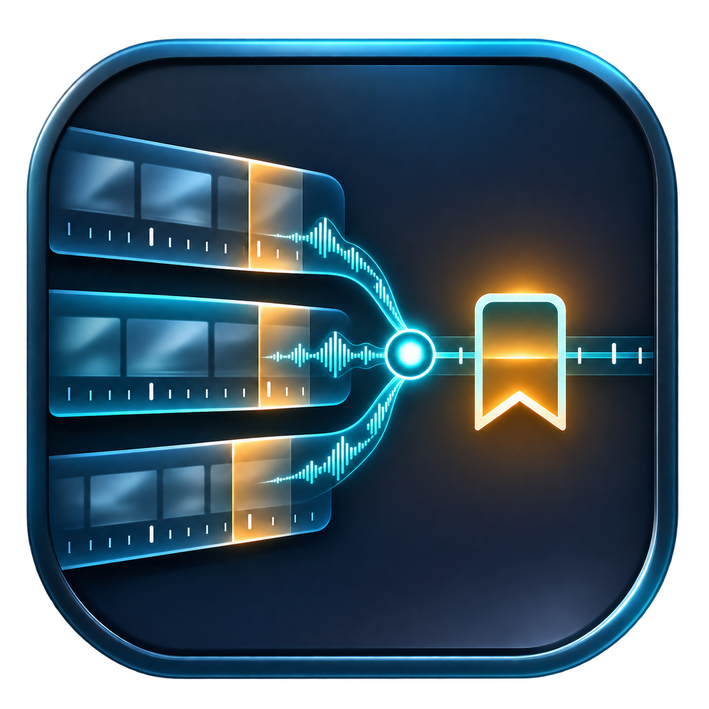
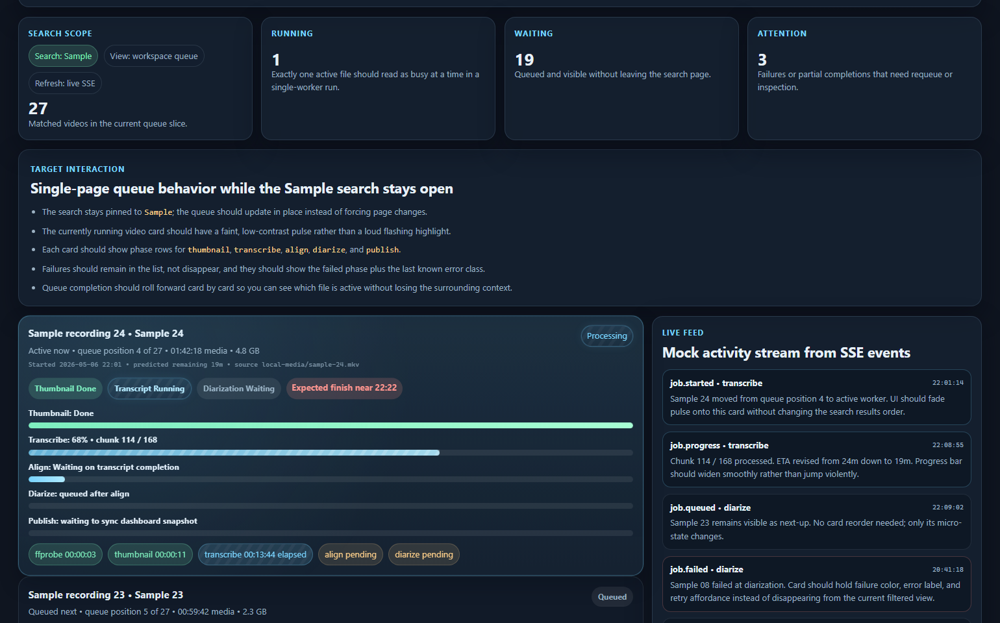
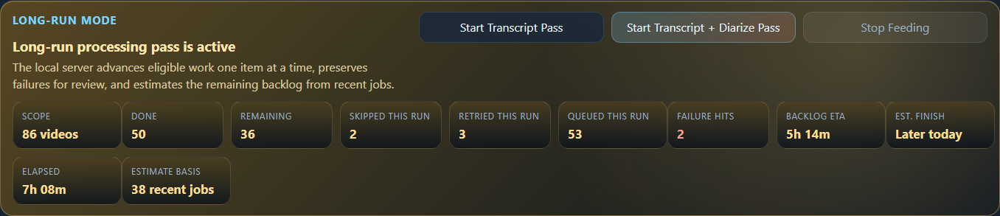
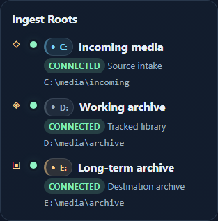
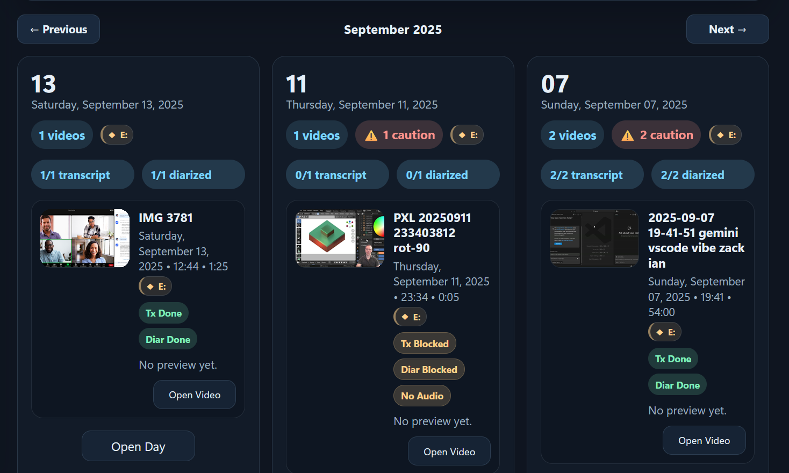
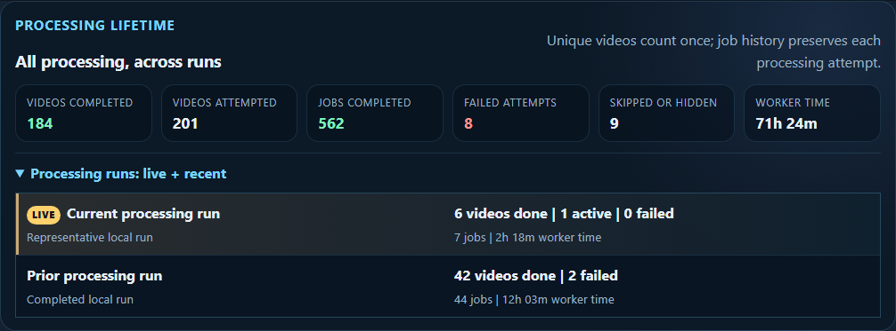
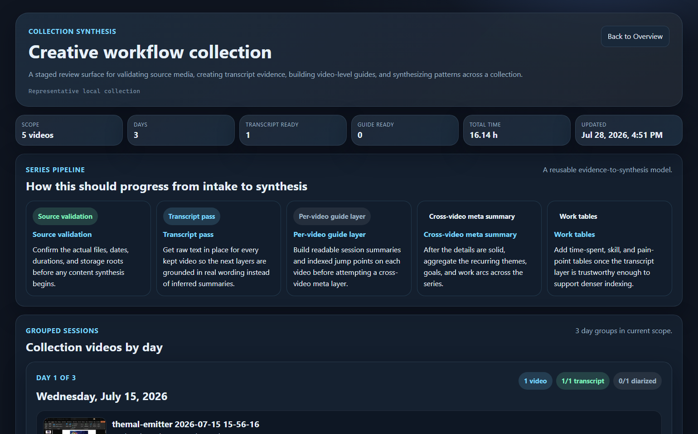
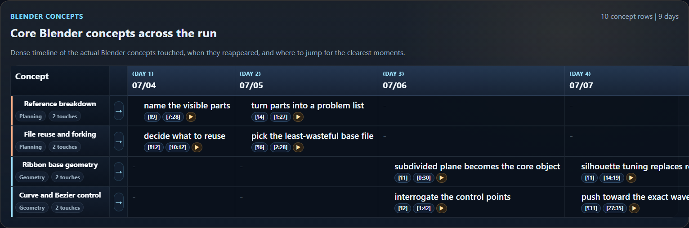
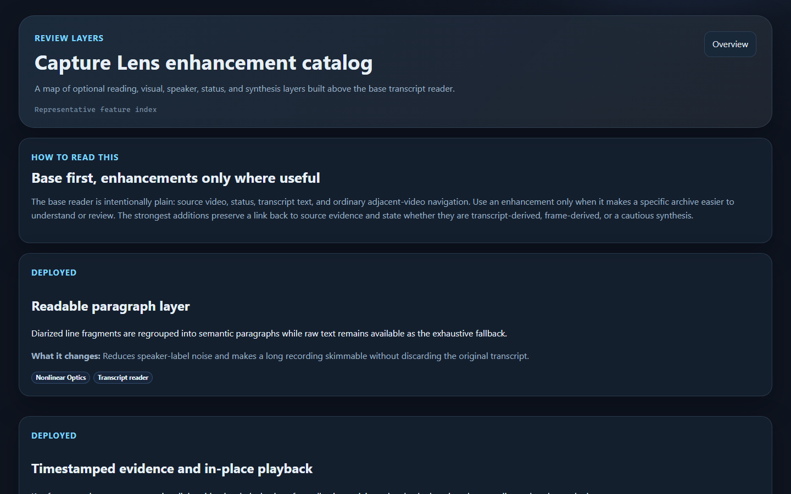
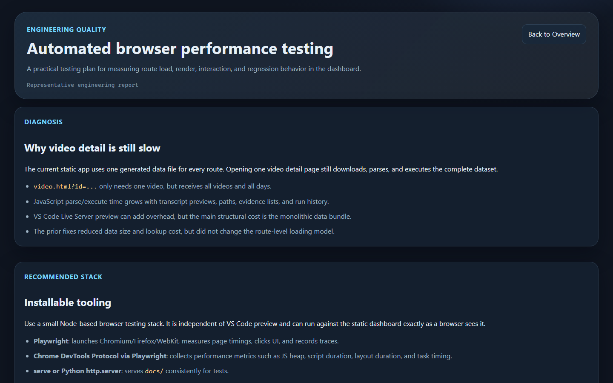

# Capture Lens

<p align="center">
  
</p>

[Architecture](#architecture) · [Run locally](#run-locally) · [Roadmap](#roadmap)

A Windows-first, local-first workspace for turning captured recordings into an organized, reviewable body of evidence. Capture Lens combines transcription, speaker diarization, thumbnails, processing controls, playback, and linked review without uploading personal source material to a hosted service.

This is both a practical tool and a portfolio project: it combines a GPU-backed WhisperX workflow with an intentionally designed dashboard for operating long-running media jobs and revisiting their results. The application keeps source media and derived personal data local; the repository contains code, templates, and sanitized portfolio captures.

> Screenshots below use synthetic labels and representative content. They do not contain local recordings, transcripts, source paths, or job history.

## Portfolio Highlights

| Area | What this project demonstrates |
| --- | --- |
| Product design | A queue-first dashboard designed around long-running work: active, waiting, failed, hidden, and completed states remain legible at a glance. |
| Systems design | An Express + SQLite control plane coordinates separate thumbnail and processing lanes, durable job records, event streaming, recovery, and disk-space safeguards. |
| Media engineering | WhisperX transcription and optional diarization, FFmpeg thumbnails, HTTP Range media delivery, timestamp playback, and local file reconciliation. |
| Information design | Calendar intake, day/video drill-down, summary-first transcript reading, stable URLs, cross-linked evidence, and series-aware navigation. |
| Operational UX | Pause-after-current, retry/remove actions, long-run feeding, explicit storage stops, interrupted-work recovery, and processing-run history. |
| Privacy-aware delivery | A public-code/private-overlay layout keeps local configuration, media, transcripts, thumbnails, logs, generated datasets, and runtime databases out of Git. |

## Product Direction

Capture Lens is designed around a simple premise: a transcript export is useful, but it is not yet a usable record of a long-running body of captured work or conversation. The current application makes individual recordings operational and reviewable; it also supports collection views when a series needs more context than a raw transcript.

The next direction is deliberately evidence-first rather than black-box analysis: make recurring ideas, decisions, concepts, difficulties, and visual references discoverable across recordings while retaining links back to the exact source moments. The current collection layouts establish that interaction model; a future reusable evidence layer would make it available without building a one-off page per collection.

## Screenshots

### Processing lifecycle



The queue design keeps the current phase, backlog, waiting work, retries, and attention states visible without reducing a multi-hour run to a spinner. The production dashboard includes live updates, persistent controls, a durable backlog feeder, per-job history, thumbnail modes, and storage safety pauses.

### Long-run control plane



A durable feeder can advance eligible work one item at a time while exposing scope, completion, retries, skipped items, failure hits, elapsed time, and an estimate grounded in recent completed jobs.

### Connected ingest roots



Configured local roots expose their distinct roles: incoming source, tracked working library, and destination archive. The scanner can reconcile recordings after moves across those roots instead of silently treating a changed path as deletion.

### Calendar-first inventory



The daily intake view combines source-origin cues, thumbnail affordances, duration, transcript/diarization coverage, and direct drill-down into one compact inventory surface.

### Lifetime and run history



Lifetime metrics distinguish unique completed videos from individual jobs and failed attempts, while the recent-run list preserves operational context across long-running sessions.

### Collection pipeline



Collections can progress from source validation through transcript evidence and video-level guides to cross-recording synthesis. This staged design keeps higher-level observations grounded in inspectable source moments rather than treating a summary as the only artifact.

### Cross-session concept evidence



Collection pages can present repeated concepts as a compact, time-aware map with direct links to the supporting paragraph, timestamp, and playback context. The review flow consistently prioritizes summaries, readable sections, timestamps, and playback links before the raw transcript, which remains an audit fallback.

### Optional review layers



The base reader remains deliberately small. Optional layers add readable paragraphs, timestamp evidence, in-place playback, visual references, speaker-aware views, and collection summaries only where they materially improve review.

### Automated browser testing



The project includes a browser-testing path for measuring route load, render cost, interaction latency, and regressions. This matters because a media archive can grow until an otherwise correct interface becomes hard to use.

## What It Does Today

### Ingest and inventory

- Scans configurable local ingest roots for supported media.
- Builds a calendar-oriented inventory with day and video detail routes.
- Generates and maintains FFmpeg thumbnails for discovered media.
- Tracks source availability and attempts to reconnect moved files across configured roots.
- Separates reachable, moved, and unreconnected media so a path change is not silently presented as deletion.

### Processing and reliability

- Queues transcript-only, transcript-plus-diarization, and thumbnail jobs through a local Express API.
- Uses SQLite for videos, jobs, steps, events, artifacts, imports, settings, and durable queue state.
- Runs media work outside the browser in a Python/PowerShell WhisperX worker path.
- Supports a long-run feeder that advances through eligible missing items without manually requeuing each file.
- Preserves attempt history; retries create additional evidence instead of erasing prior failure information.
- Detects effectively silent audio and intentionally skips text work rather than repeatedly failing it.
- Monitors free disk space and pauses new processing before a no-space condition can exhaust the machine.
- Detects sleep/resume or lost worker conditions, reconciles interrupted records, and can retry recoverable work.
- Supports pause-now, pause-after-current, resume, remove, retry, retry-all, completed, hidden, and verbose job-log views.

### Live dashboard experience

- Publishes server-sent events (SSE) for queue and video/day refreshes.
- Shows run-level lifetime metrics plus reconstructed historical processing runs.
- Keeps dashboard state in browser storage where useful: sidebar state, queue view mode, completed/hidden views, thumbnail size, transcript folds, and playback position.
- Provides hover thumbnail previews and persistent, adjustable mini-thumbnail density in the feeder view.
- Uses stable day, video, transcript, and report URLs suitable for bookmarking or sharing within a local workflow.

### Review and playback

- Provides direct local playback through the Node server, including HTTP Range handling for large media.
- Uses a disposable, configurable compatibility-playback cache that can live on a larger local drive, removes stale interrupted conversions, and stays within a size cap through least-recently-used eviction.
- Supports timestamp links, in-context playback dialogs, keyboard fullscreen, and retained playback position.
- Provides readable transcript and timestamped views ahead of the raw transcript.
- Supports speaker-aware presentation where diarization is available, while retaining uncertainty instead of treating speaker labels as ground truth.
- Adds series navigation and specialized report renderers for selected collections when a generic transcript is not enough.

### Collection lenses

- Supports collection-specific pages that layer summaries, topics, timestamp evidence, visual references, and specialized navigation above the base transcript reader.
- Keeps those additions evidence-linked: summaries can point back to readable paragraphs, timestamped text, and local playback.
- Treats these pages as collection extensions today. Cross-recording discovery is not yet a generic autonomous feature; see the roadmap for the proposed evidence-and-thread architecture.

## Architecture

```text
Configured local media roots
          |
          v
Python dashboard builder + FFmpeg thumbnails
          |
          +--> ignored generated dashboard data
          |
          v
Node importer ------------------------------+
          |                                  |
          v                                  v
SQLite state <---- Express API <---- Browser dashboard
  videos/jobs/events       |          calendar, queue, reader,
  artifacts/settings       |          playback, reports
          |                |
          |                +--> SSE state updates
          v
PowerShell + WhisperX worker
  transcript / diarization / logs / artifacts
```

### Main layers

| Layer | Responsibilities |
| --- | --- |
| `batch-whisperx.ps1` | UTF-8-safe one-file or folder processing, output/log/CSV management, resumable command-line fallback. |
| `tools/build_whisper_dashboard.py` | Scans configured roots, connects recordings with output state, prepares the dashboard read model, and creates thumbnails. |
| `server/src/` | Express API, SQLite schema/repository, durable job runner, SSE event hub, importer, local playback routes, disk guard, and recovery logic. |
| `docs/` | Dependency-light HTML/CSS/JavaScript dashboard, report pages, dialogs, queue controls, transcript reader, and responsive sidebar. |
| `config/*.example.json` | Publishable configuration shape. Real paths and private overlays stay ignored. |
| `tools/` | Environment setup, health checks, refresh/import utilities, report builders, release audit, and screenshot capture. |

### Data boundaries

The dashboard is designed as a local read/control surface rather than a hosted transcription service.

- **Tracked source:** application code, styles, templates, example config, dependency pins, tests, and sanitized screenshots.
- **Ignored local state:** media roots, recordings, transcript output, thumbnails, generated read models, logs, runtime SQLite state, tokens, and machine-specific configuration.
- **Private overlay:** an ignored `private/` folder or adjacent private repository can supply the local data/configuration required by a personal installation.

See `docs/pages/git-implementation.html` in a running local copy and `tools/audit-public-release.ps1` for the release-audit approach.

## Run Locally

### Prerequisites

- Windows 10/11 with PowerShell.
- Python compatible with the pinned CUDA/WhisperX stack.
- NVIDIA CUDA environment for the supplied GPU dependency set, or a deliberately adjusted CPU/alternate configuration.
- Node.js with support for `node:sqlite` (Node 22+ recommended).
- `ffmpeg` and `ffprobe` on `PATH`.
- A Hugging Face access token and accepted terms for the diarization model when diarization is enabled.

### Setup

```powershell
git clone https://github.com/nastajus/capture-lens.git
cd capture-lens

# Python / WhisperX environment
powershell -NoProfile -ExecutionPolicy Bypass -File .\tools\setup.ps1
powershell -NoProfile -ExecutionPolicy Bypass -File .\tools\doctor.ps1 -RequireHfToken

# Dashboard dependencies
npm ci

# Create an ignored local configuration from the tracked template.
Copy-Item .\config\whisper_dashboard_config.example.json .\config\whisper_dashboard_config.local.json
```

Edit `config/whisper_dashboard_config.local.json` with your own ingest and output roots. Do not commit it.

### Launch

```powershell
# Builds/imports the local dashboard state, starts the server, opens a browser,
# and asks the server to refresh the ingest inventory.
.\open-dashboard.ps1
```

The launcher selects a project-specific free local port to avoid collisions with other local dashboards. It validates the app identity before stopping an existing server and refuses a restart while active processing is present.

### Basic operations

```powershell
# Rebuild the static dashboard read model and thumbnails.
powershell -NoProfile -ExecutionPolicy Bypass -File .\tools\update-dashboard.ps1

# Run one file directly through the resilient WhisperX script.
powershell -NoProfile -ExecutionPolicy Bypass -File .\batch-whisperx.ps1 `
  -InputPath "C:\media\sample.mkv" `
  -Diarize

# Start the API without the launcher.
npm run server:start

# Capture the sanitized README images.
# Requires the dashboard server to be running. Set WHISPER_DASHBOARD_BASE_URL
# when it is using a non-default launcher-selected port.
npm run portfolio:screenshots
```

## Testing and Validation

```powershell
npm run server:smoke
npm run test:perf
powershell -NoProfile -ExecutionPolicy Bypass -File .\tools\audit-public-release.ps1
```

The project includes Playwright performance coverage for cold overview/day/video routes and the quick-view interaction. The release-audit script is intended to be run before publishing; `.gitignore` is helpful but does not erase files that are already tracked or present in Git history.

## Roadmap

The following are intentional next steps, not claims of completed functionality:

| Planned capability | Direction |
| --- | --- |
| Evidence graph and ThreadFinder | Normalize transcript segments into reusable evidence, index recurring terms and optional local semantic similarity, then surface reviewable cross-recording thread candidates with citations and confidence. |
| Reusable collection lenses | Convert collection-specific renderers into configurable views for themes, decisions, concepts, difficulties, speakers, action items, and visual observations. |
| Visual-first indexing | Add sampled-frame OCR and visual event extraction for screen-heavy recordings where spoken audio is not the primary evidence. |
| Better semantic review | Generalize the series-specific summary/report adapters into a configurable evidence-model pipeline with explicit confidence. |
| Deeper speaker attribution | Combine diarization, recurring topic context, and optional video-call active-speaker cues while preserving an uncertainty trail. |
| More independent runtime | Move from editor-adjacent launching toward a stable local service/host with scheduled health checks and controlled restart behavior. |
| Queue scheduling | Add priorities, retry policies, time windows, and more predictable capacity estimates for multi-day backlogs. |
| Public demonstration fixture | Provide a fully synthetic media/data fixture so the entire interface can be demonstrated and tested without local personal material. |
| Accessibility hardening | Expand keyboard coverage, screen-reader labels, reduced-motion behavior, and automated visual regression tests. |

## Why This Exists

Most transcription tools end at a file export. This project treats transcription as the beginning of a media-review workflow: recording inventory, processing observability, structured navigation, evidence links, and careful fallbacks for uncertain or incomplete automation.

The design goal is not to hide operational complexity. It is to make that complexity understandable enough that a person can leave a long run unattended, return later, and know what happened, what failed, and what to do next.

## Acknowledgements

- [WhisperX](https://github.com/m-bain/whisperX) for accelerated transcription, alignment, and diarization integration.
- [pyannote.audio](https://github.com/pyannote/pyannote-audio) for speaker diarization components.
- [FFmpeg](https://ffmpeg.org/) for thumbnail extraction and local media handling.
- [Express](https://expressjs.com/), [SQLite](https://www.sqlite.org/), and [Playwright](https://playwright.dev/) for the local control plane and test tooling.
