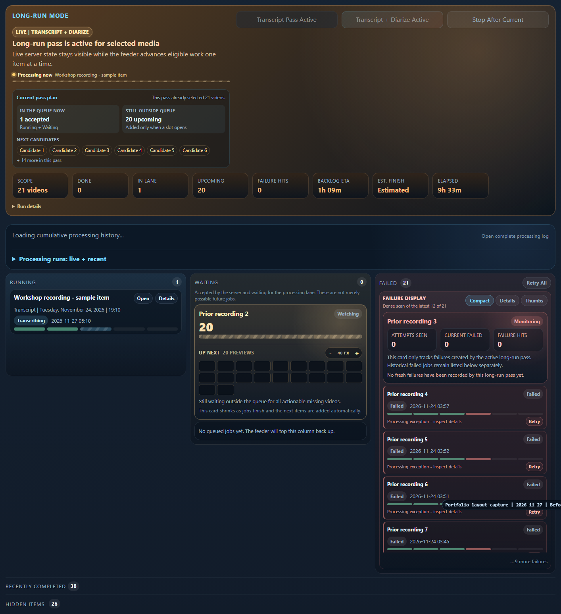
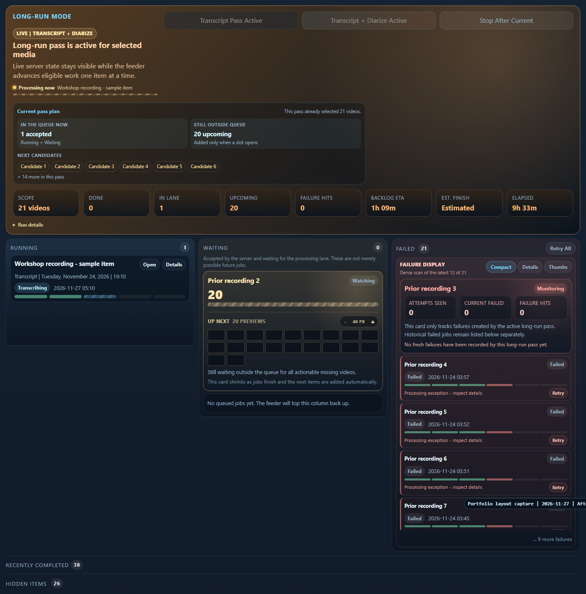
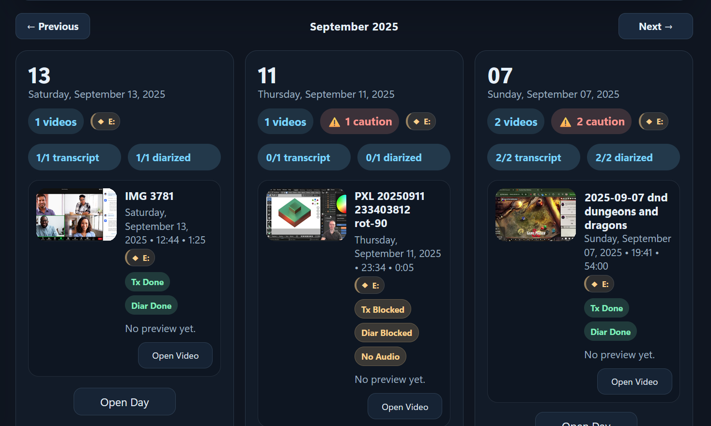
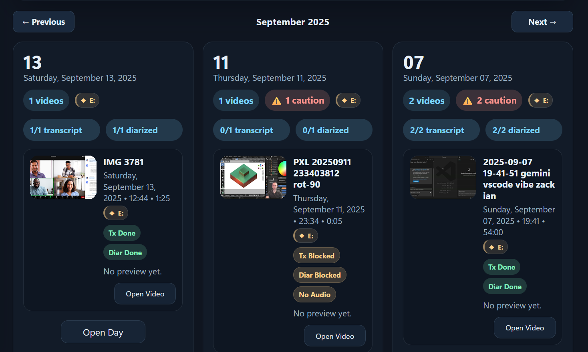

# Design Changes

[Back to Capture Lens README](../../README.md)

This page records dated interaction decisions and their evidence. The [main README](../../README.md) explains the product; this page explains why selected controls and layouts changed.

## Queue Console Design Note

**Decision date:** 2026-11-27
**Scope:** Long-run processing controls, queue visibility, failure triage, and processing-history placement.

### Problem

The original queue area mixed two different tasks:

- Operate a live, long-running pass without guessing what will run next.
- Audit historical totals and earlier runs.

Both are useful, but their combined vertical layout made the operational task less clear. A user had to scan past historical information before reaching current queue state, and start controls did not make an active durable pass obvious after refresh.

### Decision

Use an operational console for the live queue and move lifetime history into a separate collapsed audit disclosure below it.

The console has three explicit layers:

1. **Live state and controls** - A pulsing live indicator, active-item label, disabled start choices while a pass is active, and an explicit `Stop After Current` control.
2. **Plan and capacity** - Current pass scope, accepted work, upcoming work outside the queue, candidate links, and a compact metric strip.
3. **Queue lanes** - Running, accepted waiting work, and failure triage.

This separates three terms that previously looked interchangeable:

- **Running:** occupying a processing lane now.
- **Waiting:** already accepted by the server and waiting for a lane.
- **Upcoming:** eligible for the active pass but deliberately outside the server queue until capacity opens.

### Before and After

### Before - 2026-11-27

The long-run title, controls, plan, metric strip, and lifetime history competed for the same queue surface. The plan was also constrained to only part of the available width, leaving a visibly empty third column while operational context was compressed. The capture replays those prior grid constraints against the same live queue state, so the before/after comparison remains directly comparable.

### After - 2026-11-27

The top of the queue now remains dedicated to current work. A two-zone layout gives live run identity a stable left rail and gives controls plus the work plan every remaining horizontal pixel. Server-backed state is reapplied on refresh: an active pass keeps start choices disabled, names the active pass, keeps the stop action available, and shows a quiet activity signal. Historical metrics remain available but no longer sit between the controls and the queue.

### Failure Triage

The failure section uses a labelled display container so the relationship is visible:

- **Compact** is the default: dense scan, one phase label, short error excerpt, retry affordance, and stage trace.
- **Preview** adds a landscape thumbnail while retaining Compact's diagnosis/retry flow.
- **Details** preserves full item cards when diagnosis is necessary.
- **Thumbs** changes the same failure collection into a visual grid.

The selection persists locally. The auto-feeder failure tracker also supports a small thumbnail grid when failures belong to the active pass; historical failures remain separately identifiable. The documented captures intentionally retain local thumbnails rather than obscuring them.

### Accessibility and Motion

Activity is communicated by text and state as well as restrained animation. The live chip, current-item label, and button enablement continue to explain the state when motion is reduced. Animations are disabled for `prefers-reduced-motion`.

### Tradeoff

Lifetime processing metrics are still relevant to the workspace, but they are not a command surface. Keeping them adjacent but collapsed retains discoverability without forcing operational users through an audit report on every queue visit.

## Calendar Navigation Note

**Decision date:** 2026-11-25
**Scope:** Moving between intake months and scanning day cards without losing context.

### Problem

The early calendar placed navigation in a simpler pager and made day-card coverage denser than the thumbnail-first inventory could comfortably support. Switching months was possible, but the controls did not clearly frame where the user was in the archive or make large date jumps feel deliberate.

### Before - 2026-11-25

The earlier layout established the calendar-first inventory, but its pager and card density made large-scale navigation less legible.

### After - 2026-11-25

The revision separates first/previous and next/last controls around a centered month picker. Source cues, coverage pills, landscape thumbnails, and concise excerpts remain within each day card, so navigating the archive does not discard the information needed to decide what to open.

### Decision

Use the calendar as an inventory surface rather than a decorative date picker: navigation changes only the grid, preserves the current review context, and gives each card enough horizontal space for its media and processing state.
