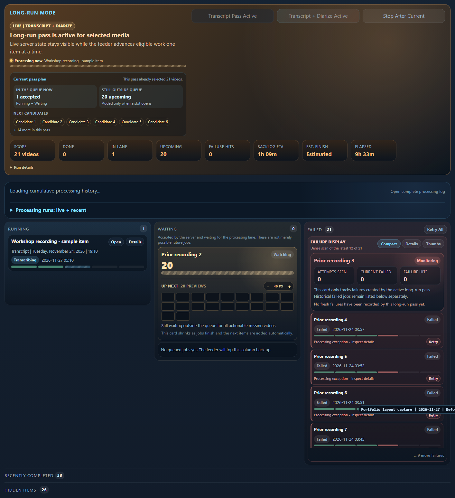
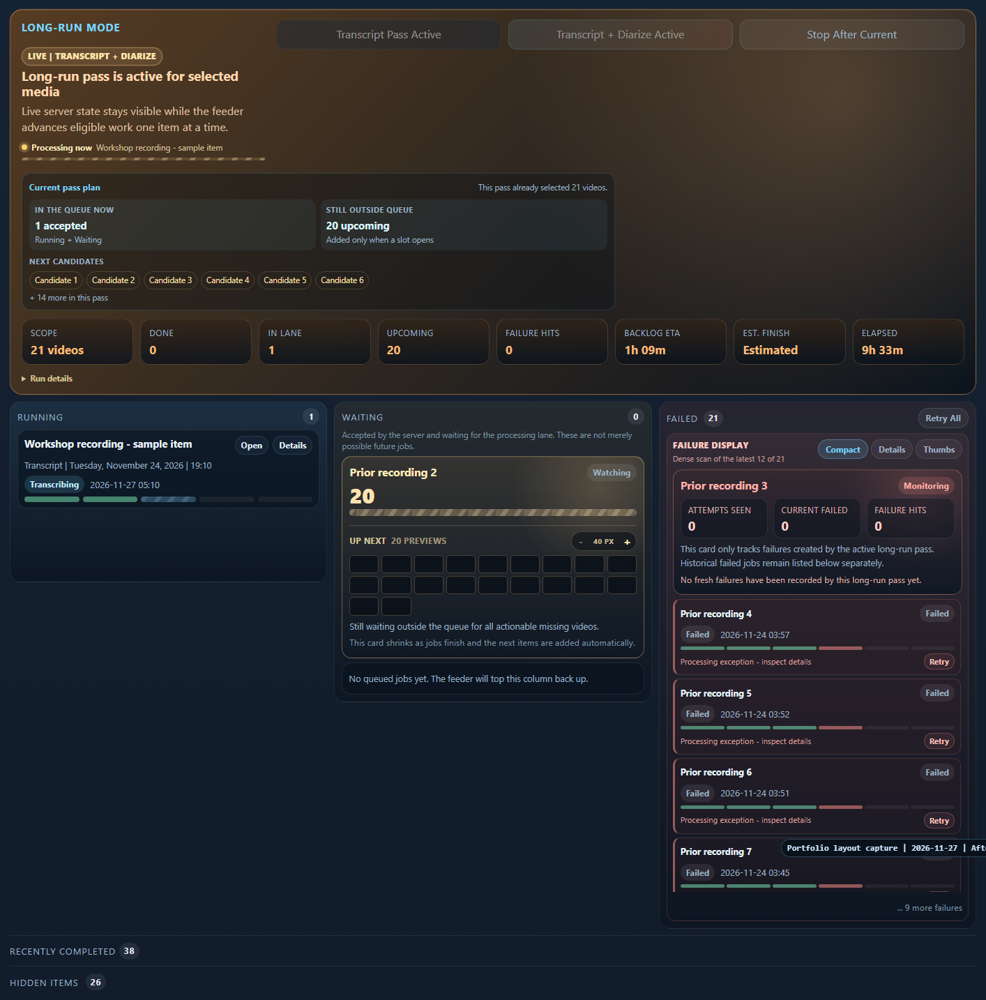

# Queue Console Design Note

**Decision date:** 2026-11-27  
**Scope:** Long-run processing controls, queue visibility, failure triage, and processing-history placement.

## Problem

The original queue area mixed two different tasks:

- Operate a live, long-running pass without guessing what will run next.
- Audit historical totals and earlier runs.

Both are useful, but their combined vertical layout made the operational task less clear. A user had to scan past historical information before reaching current queue state, and start controls did not make an active durable pass obvious after refresh.

## Decision

Use an operational console for the live queue and move lifetime history into a separate collapsed audit disclosure below it.

The console has three explicit layers:

1. **Live state and controls** - A pulsing live indicator, active-item label, disabled start choices while a pass is active, and an explicit `Stop After Current` control.
2. **Plan and capacity** - Current pass scope, accepted work, upcoming work outside the queue, candidate links, and a compact metric strip.
3. **Queue lanes** - Running, accepted waiting work, and failure triage.

This separates three terms that previously looked interchangeable:

- **Running:** occupying a processing lane now.
- **Waiting:** already accepted by the server and waiting for a lane.
- **Upcoming:** eligible for the active pass but deliberately outside the server queue until capacity opens.

## Before and After

### Before - 2026-11-27

The long-run title, controls, plan, metric strip, and lifetime history competed for the same queue surface. The controls occupied a large horizontal region without enough live context, while the audit area broke the path to the live lanes.

### After - 2026-11-27

The top of the queue now remains dedicated to current work. Server-backed state is reapplied on refresh: an active pass keeps start choices disabled, names the active pass, keeps the stop action available, and shows a quiet activity signal. Historical metrics remain available but no longer sit between the controls and the queue.

## Failure Triage

The failure section uses a labelled display container so the relationship is visible:

- **Compact** is the default: dense scan, short error excerpt, retry affordance, and stage trace.
- **Details** preserves full item cards when diagnosis is necessary.
- **Thumbs** changes the same failure collection into a visual grid.

The selection persists locally. The auto-feeder failure tracker also supports a small thumbnail grid when failures belong to the active pass; historical failures remain separately identifiable.

## Accessibility and Motion

Activity is communicated by text and state as well as restrained animation. The live chip, current-item label, and button enablement continue to explain the state when motion is reduced. Animations are disabled for `prefers-reduced-motion`.

## Tradeoff

Lifetime processing metrics are still relevant to the workspace, but they are not a command surface. Keeping them adjacent but collapsed retains discoverability without forcing operational users through an audit report on every queue visit.
